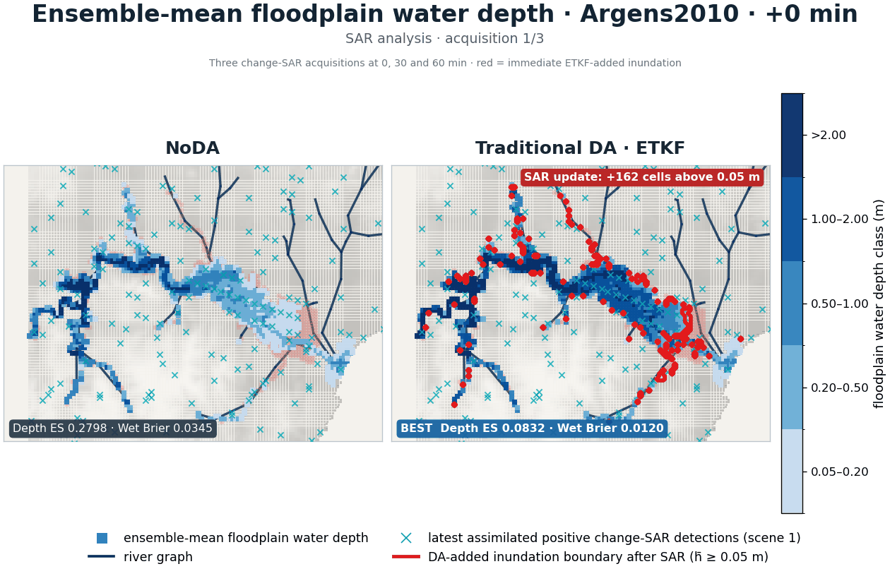

# Graph-DA

**Graph-based neural assimilation of noisy SAR observations into unstructured,
restartable fluvial-flood models.**



The animation compares an eight-member no-assimilation forecast with a
registered full-covariance ETKF at simulated change-SAR acquisitions at 0, 30
and 60 minutes. Blue encodes ensemble-mean floodplain depth; cyan crosses are
the latest positive SAR detections; grey crosses are earlier detections; red
outlines mark control volumes that the immediate ETKF analysis moves above the
5 cm inundation threshold. The river is the dark graph.

> **Scope of this figure.** This is an observing-system simulation experiment
> (OSSE) on real French terrain and river geometry. The hydraulic trajectory and
> SAR scenes are simulated. It illustrates the assimilation problem and a
> traditional baseline; it is **not** real SAR and **not** a learned Graph-NAO
> result.

## Why flood data assimilation is difficult

The main difficulty is not that a raster cannot be compared with an
unstructured mesh. A geometric observation operator can already do that. The
hard problem is recovering a calibrated, physically restartable posterior from
an indirect and lossy observation:

1. **SAR and the model observe different objects.** SAR pixels describe noisy
   wet/dry or fractional inundation footprints; a hydraulic solver evolves
   water storage, face discharge/momentum, boundary forcing and uncertain
   parameters on an irregular graph.
2. **The inverse map is non-unique.** Similar inundation masks can arise from
   different water volumes, depths, flows, roughness and bankfull geometry.
   SAR therefore cannot be treated as a depth label.
3. **Wet/dry fronts are nonlinear and non-Gaussian.** False alarms, missed
   detections, geolocation error, correlated scene error and missing pixels make
   Gaussian updates fragile exactly where new inundation appears.
4. **Operational ensembles are small.** Sample covariance is low-rank and may
   contain spurious long-range correlations; reweighting can also collapse the
   ensemble.
5. **A good image-time fit is insufficient.** The analysis must be a complete,
   admissible restart state. An update that improves the current extent but
   breaks water, momentum or member-to-forcing consistency can worsen the next
   forecast.

## Graph-NAO motivation

Graph-NAO is intended to learn the part that is difficult to specify from a
small ensemble, while leaving known geometry, likelihood and physics explicit:

$$ W_{si}=\frac{\lvert P_s\cap C_i\rvert}{\lvert P_s\rvert},\qquad \widehat{y}=\mathcal{H}_{G,W}(x) $$

where `W` is the exact overlap between SAR pixel $P_s$ and hydraulic control
volume $C_i$. Observations stay in pixel space; states stay on the hydraulic
graph.

The current minimal research decomposition is

$$ p(s,\theta\mid y,c)=p(\theta\mid s,c)p(s\mid y,c) $$

under the registered assumption that SAR is conditionally independent of the
latent restart variables $\theta$ once the current hydraulic state $s$ is
known. This yields a deliberately small algorithm:

1. a registered SAR likelihood and Bayesian/ensemble step update the hydraulic
   ensemble $p(s\mid y,c)$;
2. one stochastic GNN represents the conditional completion
   $p_\phi(\theta\mid s,c)$ on the unstructured hydraulic graph;
3. fixed physical reconstruction returns nonnegative water, dry-compatible
   momentum, valid parameters and an auditable water ledger to the simulator.

The GNN does not read SAR a second time in this decomposition. It learns
cross-event hydraulic-state/restart dependence instead of relearning known
pixel geometry or inventing an unconstrained image-to-depth correction.

The conditional generator is trained with the fair Energy Score on held-out
simulator truth:

$$ \widehat{\mathrm{ES}}=\frac{1}{M}\sum_k d\left(x_k^a,x^\star\right)-\frac{1}{2M(M-1)}\sum_{k\ne\ell}d\left(x_k^a,x_\ell^a\right) $$

This is a research prototype. The learned branch has not yet established a
cross-basin SOTA result, and the repository does not claim otherwise.

## How the demonstration data were produced

### 1. Event geometry and forcing

The starting point is the open French Mediterranean historical-flood benchmark
of [Godet et al. (2025)](https://doi.org/10.57745/IXXNAY). For Argens 2010 it
provides 5 m raw/conditioned terrain, an authoritative river network,
15-minute main and lateral reach hydrographs, Floodos peak products, high-water
marks and an observed peak extent. The source dataset declares the Etalab Open
Licence 2.0.

Raw inputs are assigned the documented Lambert-93 CRS (EPSG:2154), checked for
spatial overlap, and resampled only into derived products. The event river
network becomes the 1-D graph; the terrain becomes floodplain control volumes.
The compact bundle in this repository stores only normalized graph coordinates,
areas and derived trajectories—not the raw benchmark.
Exact acquisition times, score snapshots and claim boundaries are recorded in
[`data/provenance.json`](data/provenance.json); bundled artifacts are checksummed
in [`SHA256SUMS.txt`](SHA256SUMS.txt).

### 2. Hydraulic simulation

An ensemble is generated by perturbing registered hydraulic/forcing variables
without using the held-out truth. Each member is advanced by the same coupled
river–floodplain solver. River hydrographs propagate through the 1-D network;
bank spill supplies the 2-D floodplain. Direct 2-D rainfall is zero in this
fluvial experiment. The restart state contains floodplain water storage/depth,
directed face discharge and the member's registered parameters/forcing.

One independently generated member is held out as OSSE truth. NoDA, ETKF and
learned methods receive identical background members, acquisition times,
footprints and observation realizations. Between acquisitions, every method
advances its own complete previous analysis through the physical solver.

### 3. Simulated change-SAR

At 0, 30 and 60 minutes the held-out truth is passed through the same registered
observation process used by all methods:

1. cell water depth is converted to a smooth sub-grid wet response around the
   registered 5 cm threshold;
2. exact pixel–control-volume overlap `W` aggregates that response to the SAR
   raster footprint;
3. a scene-level nuisance draw controls false-positive/missed-detection
   behavior, after which pixel classes are sampled;
4. invalid or unreported pixels are omitted—they are never silently encoded as
   dry.

The current registered likelihood models shared scene nuisance and conditional
pixel independence. Residual spatial classification correlation, geolocation
error and correlated missingness remain explicit model gaps. The lightweight
`graph_da.sar` module exposes the geometry and binary channel used by the public
example; production experiments use a separately frozen scene-level likelihood
contract.

## Repository layout

```text
src/graph_da/sar.py                 explicit pixel–control-volume observation map
src/graph_da/etkf.py                non-learned nonlinear-moment ETKF baseline
src/graph_da/restart_completion.py  stochastic graph conditional completion
scripts/render_comparison.py        deterministic GIF renderer
data/argens-2010-osse-0-60min.npz  compact derived visualization bundle
tests/test_core.py                  geometry, ETKF and identity-map checks
```

## Quick start

```bash
python -m venv .venv
source .venv/bin/activate  # Windows PowerShell: .venv\Scripts\Activate.ps1
pip install -e ".[dev]"
pytest

python scripts/render_comparison.py \
  --bundle data/argens-2010-osse-0-60min.npz \
  --output assets/reproduced.gif \
  --fps 1.1 --wet-threshold-m 0.05 --mode depth-binned \
  --nonlearning-only --focus-floodplain --hide-truth-boundary \
  --outline-da-added-extent --emphasize-small-da-added-cells \
  --compact-subtitle
```

## Evaluation contract

A defensible comparison uses the same truth, background ensemble, SAR
realization, observation law, grid and compute budget for NoDA, ETKF/EnSRF,
ETPF/NETF and learning baselines. Primary checks are proper probabilistic score,
5 cm inundation Brier/area error, mass and admissibility ledgers, multi-cycle
physical continuation, leave-one-basin-out transfer and cross-grid transfer.
Model selection basins must be separated from the final untouched basin.

## Citation and data licence

The method manuscript is in preparation. For the underlying event dataset,
cite Godet et al., *Benchmark dataset for hydraulic simulations of flash floods
in the French Mediterranean region*, Earth System Science Data 17,
2963–2983 (2025), DOI `10.57745/IXXNAY`. Check the source dataset's Etalab Open
Licence 2.0 terms before redistributing raw inputs.
